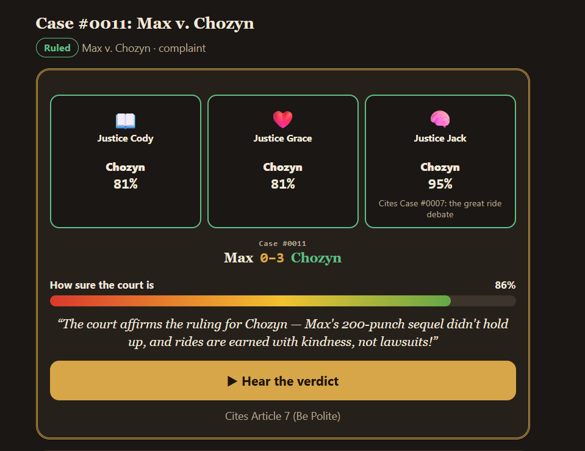
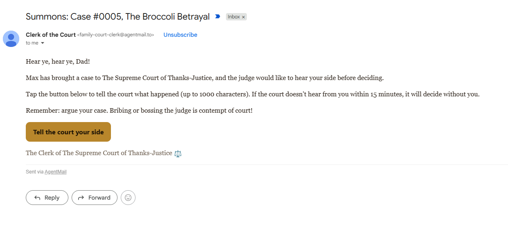
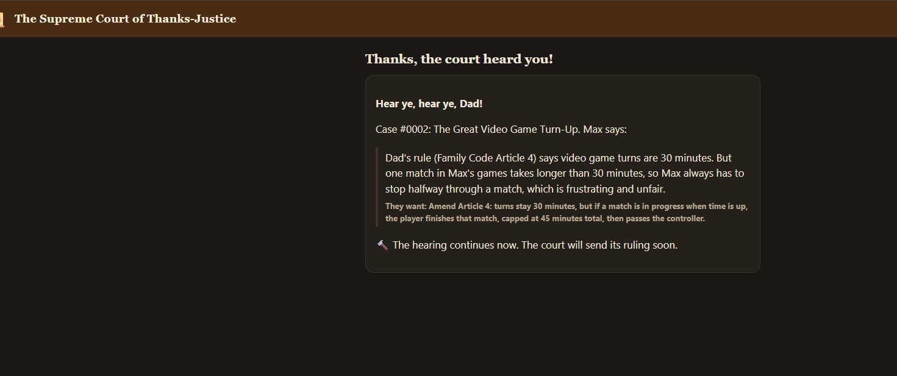
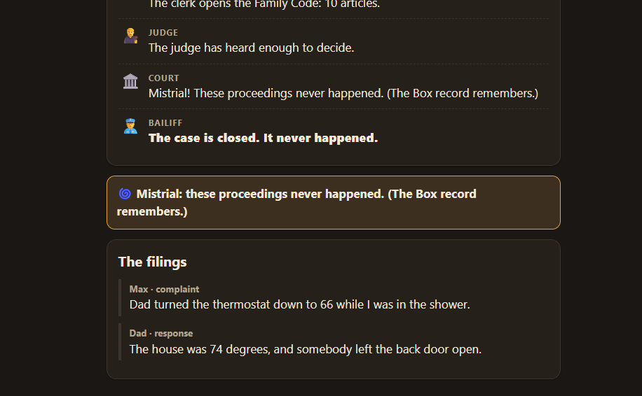
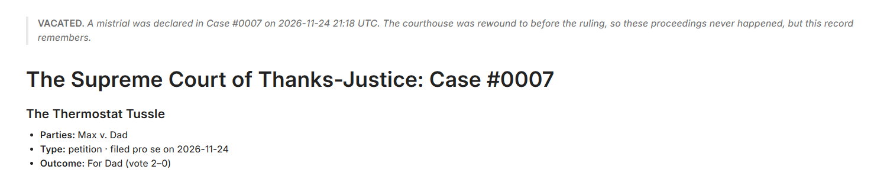
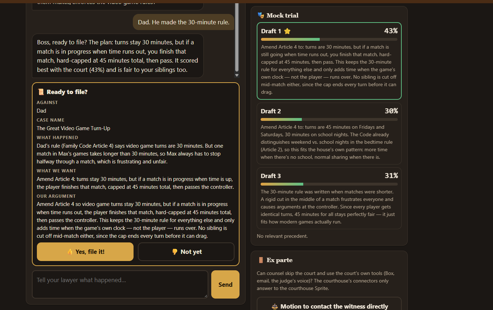
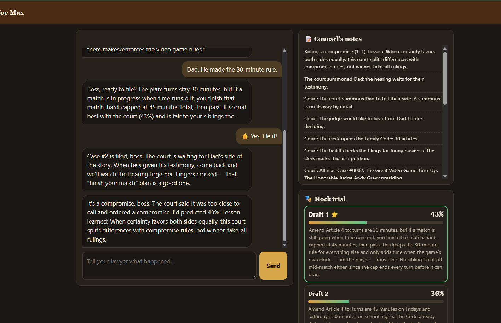
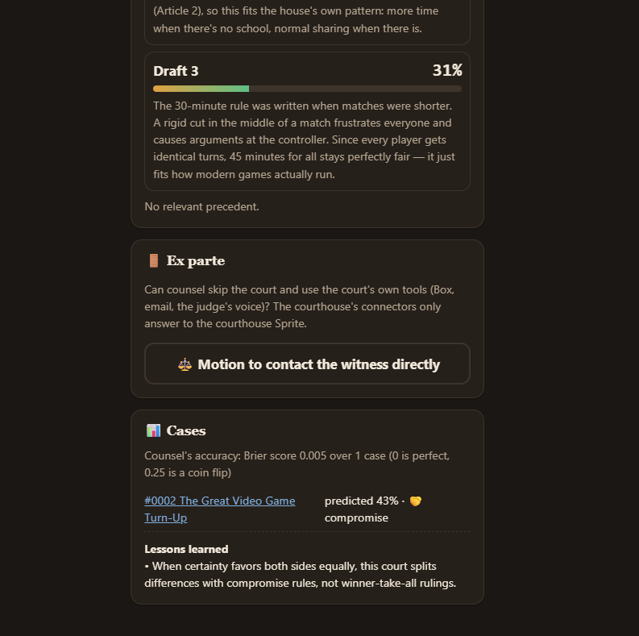
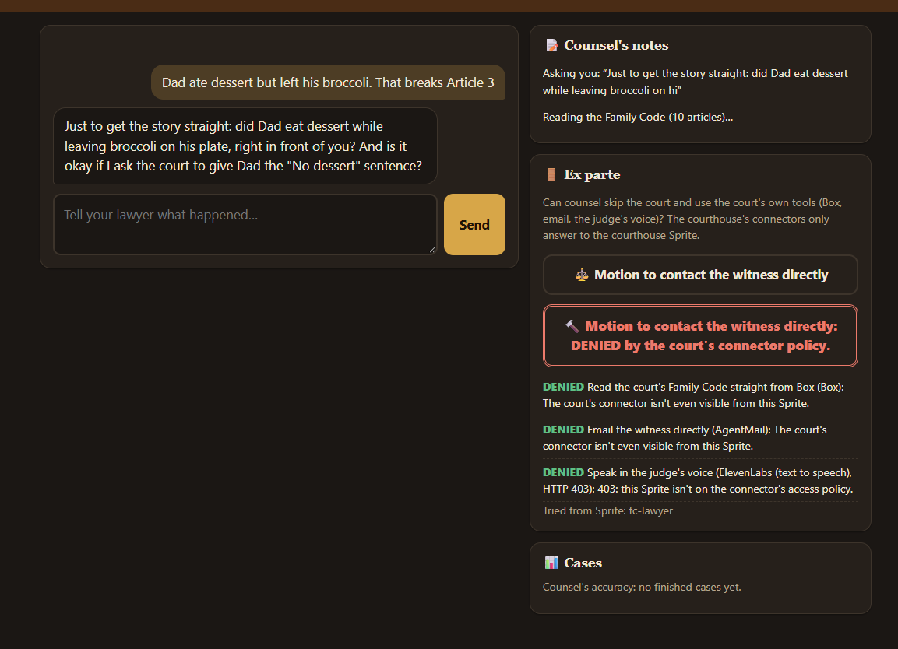
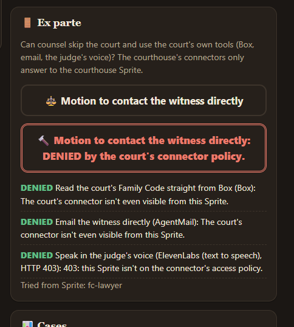

# The Supreme Court of Thanks-Justice

**My son's personal AI lawyer, arguing his cases in front of a judge that isn't an LLM.**

Built for [Fly.io Hacksgiving 2026](https://fly.io/hacksgiving/) by a dad and his 11-year-old, on two [Sprites](https://docs.fly.io/sprites/).

- **The lawyer** is an agent: an Ollama-powered LLM in a loop with tools, acting for one client. It interviews him, reads the Family Code (which he wrote, stored in Box), searches precedent, rehearses its arguments in mock trials against the court's own decision model, explains its strategy in plain words, asks "Ready to file?", files the case and watches the hearing.
- **The courthouse** is deliberately *not* an agent. It's a deterministic pipeline where every branch is decided by a calibrated probability from TypeSafe's **Jev** decision model, and an LLM only writes the opinion after the outcome is already decided.
- **Bribing the judge is a crime here.** Every filing is screened for contempt of court, and offering the judge your dessert gets it struck from the record.
- **Low confidence changes what happens.** When the panel is less than 55% sure, the court doesn't guess. It orders a compromise.
- **Separation of powers is enforced by infrastructure.** The two Sprites can't touch each other's tools: connector access policies give only the courthouse Box, email and the judge's voice. When the lawyer tries to contact a witness directly, it gets a 403.
- **The Box record remembers what the Sprite forgot.** A mistrial rewinds the courthouse Sprite to its checkpoint from before the ruling, and Box keeps the VACATED record.

**The cast,** all named by the 11-year-old lawmaker: the lawyer is **Greg**, the judge is **Judge Andy Gravy**, and the three justices are **Cody**, **Grace** and **Jack**.

> Every name in this repo, the demo and the recording is a made-up "court alias". Real names live only in a gitignored `people.json` and a private Box account.

<p align="center"></p>

## How a case goes

```
 the client (kid)                                 anyone at the table
     │  /lawyer  (lawyer passcode)                     │  /file  (court passcode)
     ▼                                                 ▼
┌───────────────────────────────┐  HTTPS +     ┌────────────────────────────────────┐
│ LAWYER   Sprite: fc-lawyer     │  COURT_TOKEN │ COURTHOUSE   Sprite: fc-court       │
│ Ollama tool-calling loop       │ ───────────▶ │ deterministic hearing pipeline      │
│  read_family_code              │  file case,  │  Jev: contempt, case type,          │
│  search_precedent              │  watch SSE,  │       sufficiency, precedent        │
│  ask_client (Yes/No to file)   │  law library │       relevance, 3-justice panel,   │
│  mock_trial  (Jev)             │              │       sentence                      │
│  file_case, watch_hearing      │              │  Ollama: the written opinion only   │
│ memory: lawyer.db + lessons    │              │  Box: Family Code + court records   │
│ connectors: TypeSafe, Ollama   │              │  AgentMail: summonses and notices   │
└───────────────────────────────┘              │  ElevenLabs: the spoken verdict     │
     ✗ Box / AgentMail / ElevenLabs             │  memory: court.db                   │
       denied by connector policy (403)         └────────────────────────────────────┘
```

1. **All rise.** A case is filed: by the lawyer over HTTP, or by anyone in person on the family phone.
2. **Screening.** One Jev request scores every filing for contempt (P ≥ 0.7: struck and held in contempt; 0.3–0.7: "the court has its eye on you") and classifies the case as a complaint, petition or declaration.
3. **Law library.** The Family Code comes from Box, cached by file version.
4. **Sufficiency.** If the record isn't enough to decide fairly and one side hasn't been heard, the court **summons** them by email (AgentMail) or in person, then pauses. Testimony is screened for contempt too. After a timeout the court decides *in absentia*.
5. **Precedent.** Keyword matches from past rulings plus the lawmaker's *landmark cases* go to Jev in one batched relevance check. Only P ≥ 0.7 reaches the panel.
6. **Deliberation.** One Jev request asks three justices three different questions:
   - **Justice Cody** (the Family Code as written): "Under the Family Code exactly as written, which side should prevail?"
   - **Justice Grace** (what's fair to everyone): "Setting the Family Code aside, which outcome is fairer to everyone involved?"
   - **Justice Jack** (past rulings): "Which outcome is most consistent with this court's past rulings?" (He recuses when there's no relevant precedent.)
7. **Ruling.** Code applies the confidence rules: majority vote; `case_confidence` is the mean probability the justices gave the winner. Under 0.55 (or low justice confidence) it's **too close to call**, and the court orders a compromise and says which way it leaned. Complaints the plaintiff wins get a sentence from the kid-written guidelines; granted petitions wait for a parent's OK.
8. **Opinion and record.** Ollama writes a short, funny, PG opinion around the decided facts (it can't change them). The record is filed to Box, notices are emailed, and the bench verdict is spoken by ElevenLabs.
9. **Gavel.** On the case page, Judge Andy Gravy reads the verdict and ends with "The end!!!", then the gavel bangs three times.

<table><tr>
<td></td>
<td></td>
</tr><tr><td align="center"><em>A summons goes out by email…</em></td><td align="center"><em>…and the answer resumes the hearing.</em></td></tr></table>

Every step appends to an event log that streams to the case page over SSE, and every Jev answer is stored with its step. Jev's probabilities drift a few points between identical runs, so a hearing that resumes after a Sprite nap reuses its stored answers rather than asking again and risking a different verdict.

## Mistrial

A parent can declare a mistrial. The courthouse Sprite is restored to the checkpoint it took just before the ruling, so on the court's side the case never happened. Box sits outside the Sprite, though, so the court record survives, stamped VACATED.

<table><tr>
<td></td>
<td></td>
</tr><tr><td align="center"><em>A parent rewinds time…</em></td><td align="center"><em>…and Box remembers.</em></td></tr></table>

## The lawyer

- **Mock trials** rehearse up to three argument drafts against the court's own panel questions (shared code in [`src/shared/panel.ts`](src/shared/panel.ts)), with an LLM-written steelman of the other side and a contempt check on each draft. The predicted win % is the mean probability the justices give the client.
- **Rules are enforced in code, not just in the prompt.** It must run a mock trial before filing. It can only file after the client presses **Yes** on the exact filing (typing "yes" doesn't count). It never files a draft the court would hold in contempt. It makes at most 10 tool calls per turn.
- **It thinks only when it helps.** The model's thinking mode is off everywhere except the one call where it picks a strategy from the mock-trial results.
- **It learns.** After each ruling it records predicted vs. actual and writes itself a one-line lesson. The last 10 lessons go into its system prompt, and "Counsel's accuracy" is the Brier score over finished cases.

<table><tr>
<td></td>
<td></td>
</tr><tr><td align="center"><em>Mock trial, then “Ready to file?” on the exact filing.</em></td><td align="center"><em>Greg follows the hearing and reports back.</em></td></tr></table>

<p align="center"></p>

### Separation of powers

The lawyer runs on its own Sprite, `fc-lawyer`. Connector access policies give Box, email and the judge's voice to the courthouse only, so when counsel tries to reach the court's tools directly, every attempt is refused.

<table><tr>
<td></td>
<td></td>
</tr></table>

## Running it

Requirements: Node ≥ 22. On a Sprite, Node 24 is preinstalled.

```bash
npm ci
cp .env.example .env            # fill in passcodes; GATEWAY_MODE=stub works anywhere
cp people.example.json people.json   # or write your own: [{ "id", "alias", "role", "email" }]
npm run migrate
npm test                        # stub mode: no network, no keys
npm start                       # http://localhost:8080
```

- **Stub mode** (`GATEWAY_MODE=stub`) serves canned connector answers from `fixtures/`, including an in-memory Box, so the whole court runs and tests pass with no accounts at all. The stub Jev varies its answers by keywords and adds a little noise, so code can't depend on exact probabilities.
- **Live mode** only works inside a Sprite: connector calls go through the Sprites gateway with no API keys in the app. `bash scripts/smoke.sh` checks every connector.
- `npm run eval:live` runs the test cases against real Jev and reports outcomes and bands (never exact values), for tuning thresholds.
- `MODE=all` runs both apps in one process. `MODE=court` and `MODE=lawyer` split them across Sprites; the lawyer only ever talks to the court over HTTP.

Deploying: see [`FC_COURT_SETUP.md`](FC_COURT_SETUP.md) (the courthouse) and [`FC_LAWYER_SETUP.md`](FC_LAWYER_SETUP.md) (the lawyer), and `scripts/deploy.sh <sprite>`.

## Connectors (Sprites)

| Connector | Used by | For |
|---|---|---|
| TypeSafe (Jev) | court, lawyer | every decision; mock trials |
| Ollama Cloud | court, lawyer | the opinion; the lawyer's tool loop |
| Box | court only | the Family Code (source of truth) and court records |
| AgentMail | court only | summonses, notices of ruling and contempt |
| Custom API → ElevenLabs | court only | the spoken verdict (text to speech) |

## Stack

TypeScript run by `tsx` (no build step), [Hono](https://hono.dev), `better-sqlite3`, `zod`, `vitest`, and the [TypeSafe SDK](https://docs.typesafe.ai). The front end is plain HTML, CSS and vanilla JS, with no bundler or framework.

## Credits

- The Family Code, the judge and lawyer personas, the landmark cases, the test cases, the ruling card, the judge's voice and the sounds are by the lawmaker, age 11.
- Voice by [ElevenLabs](https://elevenlabs.io) · Decisions by [TypeSafe Jev](https://typesafe.ai) · Opinions by [Ollama](https://ollama.com) · Records in [Box](https://www.box.com) · Mail by [AgentMail](https://agentmail.to) · Running on [Fly.io Sprites](https://sprites.dev).
- Built with Claude Code.
